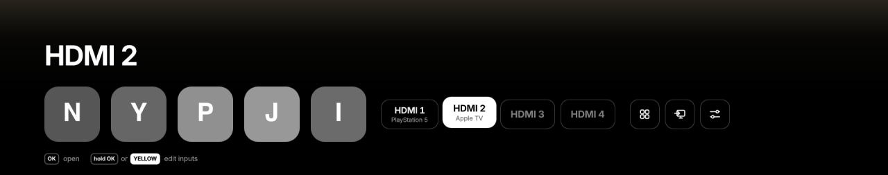

# Themes

*System → Launcher settings → Theme* changes the launcher's colours. The
values are a list; moving along it repaints the panel at once, so the list
itself is the preview. The choice is saved with the other settings and kept
by updates.

There are ten: **Default**, the launcher's original grey look, eight
two-colour themes, four on a dark base and four on a light one, and
**AMOLED**, for OLED screens: pure black and white. Under the name and the
row the shade is solid black, the tiles, pills, menu and clock bar are black
with a thin grey edge, the text and the focused tile white, there is no
coloured glow, the app icons are shown in greys and the colour keys in the
hints are white badges. Nothing keeps a colour: the edited tile's frame and
arrows, the warning before a tile is removed, the update dot and the popups'
frames are white too. (Meadow,
Sky and Violet were taken out in 0.14.0; a TV that had one of them saved
falls back to Default.)

## What the two colours do

Every theme other than Default is an **accent** and a **base**:

| | Where it shows |
| :--- | :--- |
| **Accent** | The focused tile's ring; the focused HDMI pill and System tile, filled; the dot in the clock bar; the glow in the bottom-left corner while an input, *Apps* or *System* is focused (an app keeps its own glow colour); the scroll bar in *Apps*; the focused row in the settings menu |
| **Base** | The tiles, the HDMI pills, the System tiles and the settings menu. On a light base they are light with dark text |
| **Shade** | Not chosen: always dark, a near-black of the base, under the name and the rail and behind the clock bar. The big name, the hints and the version over it stay white or light grey in every theme |

Text on the accent is white, or near-black when the accent is a light colour
(Lime, Lagoon, Midnight, Amber). Warnings and the favourite you are moving use
amber in every theme.

The pictures below are the real panel, drawn on a computer with an HDMI input
focused (see [Development](development.md#theme-pictures)). The app icons are
stand-ins.

| Theme | Colours | Accent | Base |
| :--- | :---: | :--- | :--- |
| [Default](#default) |  | `#F2F3F5` | `#26282E` |
| [Lime](#lime) |  | `#B6FF2E` | `#1F2329` |
| [Lagoon](#lagoon) |  | `#D6FFCB` | `#042F32` |
| [Midnight](#midnight) |  | `#D7FFE0` | `#050505` |
| [Amber](#amber) |  | `#FFC21A` | `#1E1B14` |
| [Terracotta](#terracotta) |  | `#E26F4A` | `#FFFCF4` |
| [Cherry](#cherry) |  | `#FF173D` | `#F9DEDF` |
| [Cobalt](#cobalt) |  | `#1D61F3` | `#F1F4F9` |
| [Indigo](#indigo) |  | `#263BAA` | `#FFF4D6` |
| [AMOLED](#amoled) |  | `#FFFFFF` | `#000000` |

## Default

The original look: grey tiles and pills, white focus, a neutral blue-grey glow.
Its accent and base above are the focused and the plain tile colours; Default
is spelled out colour by colour rather than made from two.

## Dark themes

Tiles in the base colour (Midnight's near-black base is lifted to a dark grey so
the tiles stand out from the shade), light text on them, the accent on what is
focused.

### Lime

 Accent `#B6FF2E` on graphite `#1F2329`.

### Lagoon

 Accent `#D6FFCB` on deep teal `#042F32`.

### Midnight

 Accent `#D7FFE0` on black `#050505`.

### Amber

 Accent `#FFC21A` on warm black `#1E1B14`.

## Light themes

Light tiles and pills with dark text and icons, over the same dark shade as the
dark themes, so the name and the hints stay white over any picture.

### Terracotta

 Accent `#E26F4A` on cream `#FFFCF4`.

### Cherry

 Accent `#FF173D` on blush `#F9DEDF`.

### Cobalt

 Accent `#1D61F3` on cool grey `#F1F4F9`.

### Indigo

 Accent `#263BAA` on parchment `#FFF4D6`.

## On the TV

The menu is its own preview: moving along the themes repaints the card, the
rows and the glow at once.

Terracotta on a light base, and Lime with an HDMI input focused, over a
playing video:

## Adding a theme

See [Development → Adding a theme](development.md#adding-a-theme).

## AMOLED

Pure black and white for OLED screens: a solid black shade under the name and
the row, black tiles, pills and menu with a thin grey edge, white text and
focus, no glow, app icons in greys; warnings, edit arrows and popups are white
on black as well.

